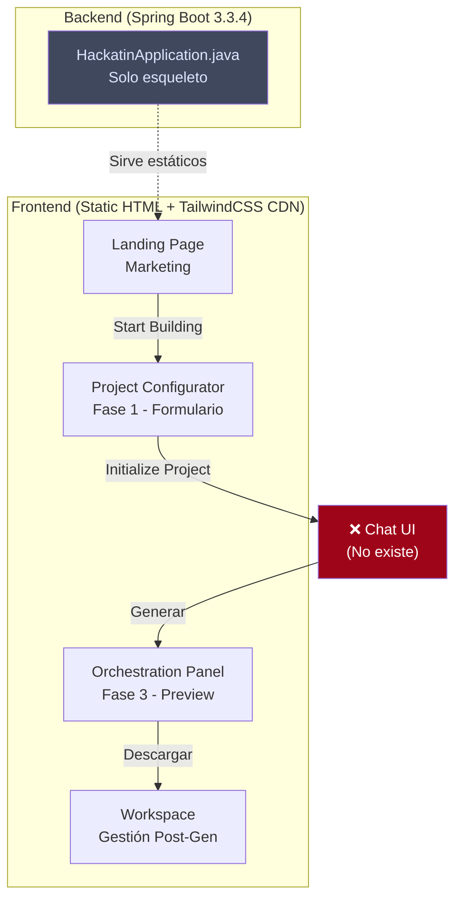

# 🔍 Análisis Completo: AgentForge (Neural Orchestration)

## Estado Actual del Proyecto

El proyecto es una **aplicación Spring Boot 3.3.4** (Java 17) que sirve páginas estáticas desde `src/main/resources/static/`. Actualmente solo tiene un `HackatinApplication.java` como punto de entrada y **sin lógica de backend implementada** (ni controladores, ni servicios, ni modelos).

Existen **4 prototipos HTML** completos + 1 documento de diseño + 1 `index.html` funcional que ya enlaza las páginas entre sí.

---

## 📐 Design System Compartido

Todas las páginas comparten un **sistema de diseño unificado** documentado en [DESIGN.md](file:///c:/Users/Dan.N/Hackatin/src/main/resources/static/aether_orchestration/DESIGN.md):

### Paleta de Colores (Material Design 3 - Dark Mode)
| Token | Hex | Uso |
|-------|-----|-----|
| `background` / `surface` | `#060e20` | Fondo base midnight blue |
| `primary` | `#3adffa` | Cyan — pathways de datos, CTAs |
| `secondary` | `#c180ff` | Purple — identidad de agentes |
| `tertiary` | `#e7ffc4` | Lime/verde — estados de éxito |
| `error` | `#ff716c` | Errores y alertas |
| `surface-container-low` | `#091328` | Paneles intermedios |
| `surface-container-high` | `#141f38` | Cards/módulos activos |
| `surface-variant` | `#192540` | Variante de superficie |

### Tipografía
- **Headlines**: `Space Grotesk` (futurista, geométrica)
- **Body / Labels**: `Inter` (alta legibilidad)

### Principios de Diseño
- ✅ **"No-Line Rule"**: Sin bordes sólidos para secciones — se usa contraste tonal
- ✅ **Glassmorphism**: `backdrop-filter: blur(20px)` con fondos semi-transparentes
- ✅ **Gradientes en CTAs**: De `primary` a `primary-container` (135°)
- ✅ **"Ghost Borders"**: Solo `outline-variant` al 15% de opacidad si es necesario
- ✅ **TailwindCSS CDN**: Configurado directamente en cada HTML con plugins `forms` + `container-queries`
- ✅ **Material Symbols Outlined**: Iconografía consistente

---

## 📄 Prototipos Existentes

### 1. Landing Page (`landing_page/code.html`)

**Lo que contiene:**
- **Hero Section**: Título "Collaborative AI Teams" con gradiente cyan→purple, subtítulo, CTAs "Start Building" + "View Documentation"
- **Stats Bar**: 99.9% Sync Accuracy, 500ms Latency, 10k+ Agents, 2026 Spec
- **"Orchestration Flow" (Bento Grid)**: 3 pasos — Describe → Select Tech → Orchestrate
- **"Specialized Agents"**: Cards de Backend Agent, Frontend Agent, Security Agent, Operations Agent con tags de tecnología
- **CTA Final**: "Ready to Architect the Future?" con glassmorphism
- **Footer** con links de navegación

**Mapping al flujo AgentForge**: Esta es la página pública de marketing. El "Start Building" debería redirigir al **Project Configurator** (Fase 1).

---

### 2. Project Configurator (`configurador_de_proyecto/code.html`)

**Lo que contiene:**
- **Layout 3-columnas**: Sidebar izquierdo + Área central + sin panel derecho
- **Step indicator**: "Step 01: Core Architecture"
- **Textarea**: "Describe your project idea" — campo libre con placeholder descriptivo + botón de micrófono
- **Tech Selector Grid (Pills)**: Grid de tecnologías seleccionables (React ✅, PostgreSQL ✅, AWS, Node.js, Python, Docker, Redis, Kubernetes, GraphQL, Terraform) — chips con bordes izquierdos en secondary cuando seleccionados
- **Status**: "Ready for synthesis" con indicador pulsante
- **Acciones**: "Save Draft" + **"Initialize Project"** (CTA principal gradient)

**Mapping al flujo AgentForge**: Esto es exactamente la **Fase 1 — Formulario Inicial**. Faltaría:
- ⚠️ Selector de **Frameworks de IA** (CrewAI, AutoGen, LangChain, Assistants API)
- ⚠️ **Validación de incompatibilidades** (pills naranja + toast)
- ⚠️ Transición a la **Fase 2 (Chat)** al hacer clic en "Initialize Project"

---

### 3. Orchestration Panel (`panel_de_orquestaci_n/code.html`)

**Lo que contiene:**
- **Layout completo 3-paneles**: Sidebar (264px) + Canvas central + Panel derecho (320px)
- **Canvas Central — "Agent Swarm V2.4"**: Visualización tipo bento de agentes con flow-lines animadas:
  - **Lead Architect** (Master Orchestrator) — estado PROCESSING, barra progreso 75%
  - **Security Guard** — estado IDLE, output de monitorización en monospace
  - **Backend Dev** — estado GENERATING SCHEMA, 88% complete
  - **Frontend Specialist** — estado WAITING FOR ASSETS
  - **Session Stats**: Tokens (142.8k), Pipelines (12), Latency (24ms)
- **Panel Derecho — "Global Events"**: Log de eventos en tiempo real con timestamps
- **Bottom CTA**: "Create New Agent"

**Mapping al flujo AgentForge**: Esto es la **Vista de Preview/Resultado** (Fase 3) — donde el usuario ve los agentes generados, sus roles y conexiones. También podría servir como dashboard post-generación.

---

### 4. Workspace (`espacio_de_trabajo/code.html`)

**Lo que contiene:**
- **Layout 3-paneles**: Sidebar + Canvas central (grid 12-col)
- **Terminal "LIVE_AGENT_STREAM_LOGS"**: Simulación de terminal con logs de agentes en tiempo real con colorcoded entries
- **File Explorer**: Árbol de archivos del proyecto (src/agents/, config/, project_manifest.json, deployment_hook.js)
- **"Strategic Milestones"**: Timeline vertical con estados ✅ COMPLETE, 🔵 IN PROGRESS (68%), 🔒 LOCKED
- **"Generated Assets"**: Grid 2x2 de assets generados con preview (Visual_Logic_Map, System_Architecture_SVG, API_Documentation, Security_Log_Report)
- **FAB Button**: Icono de smart_toy para crear agentes

**Mapping al flujo AgentForge**: Esto es el **Workspace completo** post-generación — donde el usuario gestiona, descarga y revisa los archivos generados.

---

### 5. Index.html (Hub de navegación)

El archivo raíz `index.html` es una copia de la landing page **pero con enlaces funcionales**:
- Projects → `configuracion_proyecto.html`
- Agents → `pagina_orquestacion.html`  
- Workspace → `espacio_trabajo.html`

> [!WARNING]
> Los nombres de archivo referenciados en `index.html` no coinciden con los directorios existentes. Esto sugiere que las páginas actuales son prototipos y aún necesitan reestructurarse como páginas definitivas.

---

## 🔴 Gaps Identificados vs. Visión AgentForge

| Componente | Estado | Prioridad |
|-----------|--------|-----------|
| **Landing Page** | ✅ Completa | — |
| **Formulario Inicial (Fase 1)** | ⚠️ Parcial — falta selector de frameworks IA + validación | Alta |
| **Chat de Refinamiento (Fase 2)** | ❌ No existe | **Crítica** |
| **Quick Reply Buttons** | ❌ No existe | Alta |
| **Panel de Contexto Acumulado** | ❌ No existe | Alta |
| **Vista Preview Agentes (Fase 3)** | ⚠️ Base en Panel Orquestación | Media |
| **Botón "Generar Agentes"** | ❌ No existe | Alta |
| **Descarga ZIP** | ❌ No existe | Alta |
| **Sidebar con Historial de Proyectos** | ⚠️ Estructura de sidebar existe pero sin historial dinámico | Media |
| **Backend API (Spring Boot)** | ❌ Solo esqueleto vacío | **Crítica** |
| **Integración con GPT/IA** | ❌ No implementada | **Crítica** |
| **Autenticación de usuario** | ❌ No existe | Media |
| **Base de datos** | ❌ No configurada | Alta |

---

## 🏗️ Resumen de Arquitectura Actual

---

## ✅ Confirmación de Recepción — Resumen en 3 puntos

1. **AgentForge es un SaaS de "Ingeniería de Agentes" visual** — el usuario describe su proyecto + elige stack, la IA (GPT-5.2) le guía en un chat de refinamiento, y al final genera un ZIP descargable con configuraciones JSON/Python para frameworks como CrewAI o AutoGen. El producto **no ejecuta agentes**, solo genera la receta técnica.

2. **Ya existe un sistema de diseño premium y 4 prototipos HTML de alta fidelidad** con una estética "Synthetic Architect" (dark mode, glassmorphism, gradientes cyan/purple/lime, Space Grotesk + Inter). El flujo visual Fase 1 (Configurator) → Fase 3 (Preview) → Workspace está parcialmente cubierto, pero **falta el componente más crítico: la interfaz de Chat (Fase 2)** y el panel de contexto acumulado.

3. **El backend es un Spring Boot vacío** — no hay controladores, servicios, modelos, base de datos ni integración con IA. Todo el trabajo de lógica está por hacer: API REST para sesiones/chat, integración OpenAI, gestión de estado de conversación, y generación del ZIP final.

---

## ❓ ¿Por dónde empezamos?

Hay varios bloques posibles para arrancar. ¿Cuál prefieres?

| Opción | Bloque | Descripción |
|--------|--------|-------------|
| **A** | 🎨 **Chat UI (Fase 2)** | Diseñar e implementar la interfaz de chat + panel de contexto acumulado + quick replies |
| **B** | 📝 **Completar Formulario (Fase 1)** | Añadir selector de frameworks IA, validación de incompatibilidades, y conectar con la transición al chat |
| **C** | ⚙️ **Backend API** | Crear los controladores Spring Boot, modelos de sesión, y la lógica de integración con OpenAI |
| **D** | 🔗 **Unificar Páginas** | Reestructurar los prototipos en una SPA o en páginas enlazadas con navegación real y estado compartido |
| **E** | 🚀 **Full Stack: Fase 1 → Fase 2** | Hacer el flujo completo desde formulario hasta chat con backend funcional |

Dime por qué bloque de código o diseño quieres empezar.
